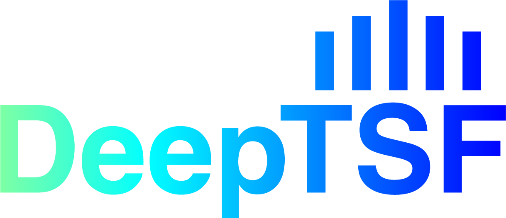

<p align="center">
  <a href="https://doi.org/10.1016/j.softx.2024.101758">
    
  </a>
</p>
<p align="center">
    ✨ DeepTSF is designed to enable codeless machine learning operations for time series forecasting ✨
</p>

<p align="center">
    🙌 Refer to <b><a href="https://github.com/epu-ntua/DeepTSF/wiki/DeepTSF-documentation">https://github.com/epu-ntua/DeepTSF/wiki/DeepTSF-documentation</a></b> for the documentation 📖
</p>

[](https://github.com/epu-ntua/DeepTSF/blob/dev/LICENSE.txt) [](https://doi.org/10.1016/j.softx.2024.101758)

## Installation

To set up DeepTSF on your local system, you need to clone the master branch of this repository:

```git clone https://github.com/epu-ntua/DeepTSF.git```

Use the master branch: the older GitHub releases (up to v1.1.0) pull MinIO images that are no longer published on Docker Hub, so they no longer start.

After that you need to navigate to the root directory of DeepTSF:

```cd /path/to/repo/of/DeepTSF```

To enable the communication of the client with the logging servers (MLflow, Minio, Postgres), a .env file is needed. 
An example (`deeptsf_backend/.env.example`) is provided, with default environment variables.

After that, you can set up a full deployment of DeepTSF using Docker. There are two variants:

| Variant | Compose file  | Authentication | Runs |
| --- | --- | --- | --- |
| **Local** (this section) | `deeptsf_backend/docker-compose.yml`  | none | the whole stack on one machine |
| **Keycloak** ([below](#deployment-with-keycloak-authentication)) | `deeptsf_backend/docker-compose-keycloak.yml` | Keycloak, through `oauth2proxy/` | backend, worker, Dagster and Chronos-2, next to existing MLflow / MinIO / Postgres |

### Set up locally using Docker

The local deployment is defined in `deeptsf_backend/docker-compose.yml`. It runs everything on one machine, without authentication:
MinIO, Postgres, MLflow, the backend, the Celery worker, Redis, Dagster, the Chronos-2 inference server and the dashboard.

#### First start

Go to the `deeptsf_backend` directory and create the .env file from the example:

```
cd deeptsf_backend
cp .env.example .env
```

The backend, worker and Dagster images are built on top of a separate **conda base image** (`deeptsf-base:local`) that holds the conda environment. Run these steps one at a time and let each one finish:

```
# 1. Optional: free stale build cache (safe, it only holds intermediate build steps)
docker builder prune -f

# 2. Build the conda base image.
docker compose --profile base build conda-base

# 3. Check that the image exists
docker images deeptsf-base

# 4. Build backend, worker and dagster on top of it (a few minutes)
docker compose build

# 5. Start everything from the new images
docker compose up -d --no-build
```

On first start the Chronos-2 server also downloads the `amazon/chronos-2` weights from HuggingFace (kept in a docker volume afterwards).

DeepTSF is up and running. Navigate to [http://localhost:3000](http://localhost:3000) and start your experiments!

#### Ports

The services are available at:

| Service | URL | Host port variable in .env |
| --- | --- | --- |
| Dashboard | http://localhost:3000 | `DASHBOARD_HOST_PORT` |
| Backend API (Swagger) | http://localhost:8080/docs | `BACKEND_PORT` |
| MLflow | http://localhost:5000 | `MLFLOW_HOST_PORT` |
| Dagster | http://localhost:8006 | `DAGSTER_HOST_PORT` |
| MinIO API / console | http://localhost:9000 / http://localhost:9001 | `MINIO_HOST_PORT` / `MINIO_CONSOLE_HOST_PORT` |
| Postgres | localhost:5432 | `POSTGRES_HOST_PORT` |
| Chronos-2 API (Swagger) | http://localhost:8010/docs | `CHRONOS_PORT` |

The values above are the defaults. If a port is already taken on your machine, change its variable in .env and run `docker compose up -d --no-build`.


### Deployment with Keycloak authentication

The Keycloak variant is for a shared server where users log in through Keycloak. It is defined in `deeptsf_backend/docker-compose-keycloak.yml` and differs from the local setup. It has four parts:

- the DeepTSF stack in `deeptsf_backend/docker-compose-keycloak.yml`: backend, Celery worker, Redis, Dagster and Chronos-2;
- the `oauth2proxy/` stack, which puts a Keycloak login in front of the Dagster UI;
- an MLflow tracking server with a MinIO / S3 artifact store, set up separately (see below);
- the DeepTSF dashboard, from [deeptsf-dashboard](https://github.com/epu-ntua/deeptsf-dashboard), deployed separately (see [Deploy the dashboard](#deploy-the-dashboard)).

You need:

- a Keycloak instance with a realm for DeepTSF, where you can create clients and roles (see [Keycloak clients](#keycloak-clients) and [Keycloak roles](#keycloak-roles));
- a reverse proxy that terminates HTTPS, e.g. [Nginx Proxy Manager](https://github.com/NginxProxyManager/nginx-proxy-manager). The oauth2-proxy login only works over HTTPS (secure cookies, `https://` redirect URL). It must be on the `keycloak_net` network (or your `COMPOSE_NETWORK`) and route one host name per service:

| Public host (example) | Forward to |
| --- | --- |
| `deeptsf.<domain>` (`DASHBOARD_HOST`) | the [dashboard](#deploy-the-dashboard) container |
| `deeptsf-backend.<domain>` | `${BACKEND_CONTAINER}:${BACKEND_PORT}` (default `DeepTSF-backend:8081`) |
| `deeptsf-dagster.<domain>` (`DAGSTER_PUBLIC_HOST`) | `oauth2_proxy_dagster:4180`, **not** Dagster itself |
| `deeptsf-chronos.<domain>` | `${CHRONOS_HOSTNAME}:8000` |

#### Choose an MLflow server

DeepTSF works with either kind of MLflow tracking server. Both must serve the artifacts themselves: run them with `--serve-artifacts --artifacts-destination s3://<bucket>` rather than `--default-artifact-root s3://<bucket>` (see the `mlflow_server` service in `deeptsf_backend/docker-compose.yml`).

**Plain MLflow (no login).** Our [epu-ntua/mlflow](https://github.com/epu-ntua/mlflow) is a plain, local MLflow server:

```
git clone https://github.com/epu-ntua/mlflow.git
cd mlflow
cp .env.example .env                  # fill in the Postgres and MinIO values and BUCKET_NAME
docker network create keycloak_net    # only if it does not exist yet; the MLflow stack joins it
docker compose up -d
```

Use its `docker-compose.yml`, which serves the artifacts as described above; its `docker-compose_simple.yml` does not.


**MLflow with Keycloak login (optional).** If you want users to log in to MLflow and only see their own experiments, use [mlflow-oidc-auth](https://github.com/mlflow-oidc/mlflow-oidc-auth) with your Keycloak realm instead (see its documentation for the server setup). MLflow then identifies each user by the `email` claim of their token. Dagster runs can take hours, longer than an access token lives, so in this case you also need the Dagster offline client and the `KC_OFFLINE_*` / `EG_TOKEN_ENC_KEY` variables: the Dagster worker uses each user's offline token to keep authenticating to MLflow for the whole run.

The MLflow server and DeepTSF may run on different computers. In this case, set `MLFLOW_TRACKING_URI` and `MLFLOW_S3_ENDPOINT_URL` in the .env file accordingly.

#### First start

```
cd deeptsf_backend
cp .env.auth.example .env          # fill in the Keycloak, MLflow, MinIO and Postgres values
                                   # CHRONOS_API_TOKEN is required: openssl rand -hex 32
                                   # DAGSTER_ENDPOINT_URL=https://<DAGSTER_PUBLIC_HOST>
                                   # CORS_EXTRA_ORIGINS=https://<DASHBOARD_HOST>,https://<DAGSTER_PUBLIC_HOST>
                                   #   (unless they are already in api.py's built-in CORS list)

# One-off setup
docker network create keycloak_net        # or your COMPOSE_NETWORK, if it does not exist yet
docker volume create eg_offline_tokens    # shared with the oauth2proxy stack

# 1. Build the conda base image (~30+ minutes; shared by every project on the machine)
docker compose -f docker-compose-keycloak.yml --profile base build conda-base

# 2. Check that the image exists
docker images deeptsf-base-keycloak

# 3. Build backend, worker and dagster on top of it (a few minutes)
docker compose -f docker-compose-keycloak.yml build

# 4. Start the stack
docker compose -f docker-compose-keycloak.yml up -d --no-build
```

The backend launches the dashboard's Dagster runs through `DAGSTER_ENDPOINT_URL`, so it must be the public Dagster URL behind oauth2-proxy, not the Dagster container.

#### Start the oauth2proxy stack

The `oauth2proxy/` stack runs oauth2-proxy and a small gateway in front of Dagster (reverse proxy → `oauth2_proxy_dagster:4180` → `dagster_gateway:8090` → Dagster). Create its .env from the example and fill it in:

```
cd ../oauth2proxy
cp .env.example .env
docker compose -p deeptsf-oauth2proxy up -d
```

| Variable | Value |
| --- | --- |
| `DAGSTER_PUBLIC_HOST` | public host name of the Dagster UI, e.g. `deeptsf-dagster.example.org` (no `https://`) |
| `COOKIE_DOMAIN` | domain the login cookie is valid for, e.g. `.example.org` |
| `KC_ISSUER_URL` | `https://<keycloak>/realms/<realm>` |
| `KC_CLIENT_ID`, `KC_CLIENT_SECRET` | the Dagster UI login client (below) |
| `OAUTH2_COOKIE_SECRET` | `openssl rand -base64 32 \| tr -- '+/' '-_'` |
| `OAUTH2_EXTRA_AUDIENCE` | optional: extra token audiences to accept, comma separated. `KC_CLIENT_ID` and `account` are always accepted. The backend forwards the dashboard user's token to Dagster, so that token's audience must be one of them |
| `DAGSTER_HOSTNAME` | must match `DAGSTER_HOSTNAME` in `deeptsf_backend/.env` (`dagster` if you did not set it) |
| `REDIS_HOST`, `REDIS_PASSWORD` | must match `deeptsf_backend/.env` (`redis` and empty if you did not set them) |
| `KC_OFFLINE_ID`, `KC_OFFLINE_SECRET` | MLflow with Keycloak login only: the Dagster offline client. Leave empty for plain MLflow |
| `EG_TOKEN_ENC_KEY` | MLflow with Keycloak login only: key that encrypts the stored offline tokens, `python -c "from cryptography.fernet import Fernet; print(Fernet.generate_key().decode())"`. Leave empty for plain MLflow |

Set `KC_OFFLINE_ID`, `KC_OFFLINE_SECRET` and `EG_TOKEN_ENC_KEY` to the **same** values in `deeptsf_backend/.env`, or leave them empty in both. If they are set, every run needs the launching user's offline token, and a user only gets one by opening the Dagster UI in the browser once. Until they do, the runs they start from the dashboard fail with `No offline token stored for <user>`.

#### Deploy the dashboard

The web interface is the DeepTSF dashboard. How to build, configure and deploy it, including with Keycloak, is described in its repository: [epu-ntua/deeptsf-dashboard](https://github.com/epu-ntua/deeptsf-dashboard).

#### Keycloak clients

Create these clients in the realm (*Clients → Create client*, OpenID Connect). All are confidential: turn *Client authentication* on and copy the secret from the *Credentials* tab.

| Client | Needed for | Used by | Settings | Variables |
| --- | --- | --- | --- | --- |
| Backend (e.g. `deeptsf-backend`) | always | the DeepTSF backend, to validate users' tokens through the introspection endpoint | *Standard flow* and *Direct access grants* on. Valid redirect URIs and web origins: the dashboard, backend and Dagster public URLs (e.g. `https://<DASHBOARD_HOST>/*`, `https://<BACKEND_HOST>/*`, `https://<DAGSTER_PUBLIC_HOST>/*`) | `KEYCLOAK_ID`, `KEYCLOAK_SECRET` in `deeptsf_backend/.env`; `TOKEN_ISSUER_URL=https://<keycloak>/realms/<realm>/protocol/openid-connect/token` |
| Dagster UI login (e.g. `dagster`) | always | `oauth2_proxy_dagster`, which puts a Keycloak login in front of the Dagster UI | *Standard flow* on. Root URL `https://<DAGSTER_PUBLIC_HOST>`; valid redirect URI `https://<DAGSTER_PUBLIC_HOST>/*` (covers `/oauth2/callback`); valid post logout redirect URI `https://<DAGSTER_PUBLIC_HOST>/*`; front- and backchannel logout URL `https://<DAGSTER_PUBLIC_HOST>/oauth2/sign_out`. **MLflow with Keycloak login only:** add an *Audience* mapper (*Client scopes → dedicated scope → Add mapper → By configuration → Audience*, added to the access token and introspection) whose included client audience is your MLflow client | `KC_CLIENT_ID`, `KC_CLIENT_SECRET` in `oauth2proxy/.env` |
| Dagster offline (e.g. `dagster-offline`) | MLflow with Keycloak login only | the Dagster gateway, which gets each user an offline token, and the Dagster worker, which uses it to refresh the user's access token during long runs | *Standard flow* on, *Direct access grants* off. Valid redirect URI `https://<DAGSTER_PUBLIC_HOST>/eg-auth/callback`, web origin `https://<DAGSTER_PUBLIC_HOST>`. `email` and `profile` as default client scopes and `offline_access` as a default or optional one (Keycloak's defaults). The gateway always sends PKCE (`S256`), so enforcing it on the client is optional | `KC_OFFLINE_ID`, `KC_OFFLINE_SECRET` in `oauth2proxy/.env` **and** in `deeptsf_backend/.env` |

With MLflow with Keycloak login, the tokens must include the `email` claim (the default `email` client scope), and `EG_OFFLINE_SESSION_IDLE_DAYS` in `oauth2proxy/docker-compose.yml` must match the realm's *Offline Session Idle* (*Realm settings → Sessions*, 30 days by default), or the client's own value if you override it under *Advanced*.

#### Keycloak roles

The backend authorizes every request by the **realm roles** in the user's token (`realm_access.roles`, read through Keycloak's token introspection endpoint). Create these roles in the realm (*Realm roles → Create role*) and assign them to users (*Users → \<user\> → Role mapping*) or to a group:

| Realm role | Gives access to |
| --- | --- |
| `inergy_admin` | everything, including the admin-only endpoints: system monitoring (CPU / memory / GPU usage), the MLflow tracking URI and the hyperparameter entrypoints |
| `data_scientist` | uploading datasets, listing models, running the experimentation pipeline and the task status websocket |
| `energy_engineer` | model evaluation and serving: experiment lists, metrics, evaluation series, forecast vs. actual and `/serving/get_result` |
| `offline_access` | MLflow with Keycloak login only: the gateway asks for an offline token, which Keycloak only issues to users with this role. It is a default realm role, so check it has not been removed |

Every logged-in user needs at least one of `inergy_admin`, `data_scientist` or `energy_engineer`; without one, the backend answers `403`. A user who should run experiments and also evaluate them needs both `data_scientist` and `energy_engineer` (or `inergy_admin`). If the dashboard is built with `REACT_APP_EXPERIMENT_LIST=True`, its experiment form loads the experiment list, which is an `energy_engineer` endpoint, so running experiments then also needs `energy_engineer`.

## Dagster UI for advanced users

For users that require advanced pipeline parameterization and functionalities such as hyperparameter tuning,
a dagster based pipeline is provided. By modifying the config of deeptsf_dagster_job, the user can set all parameters 
described in the extensive documentation of DeepTSF. An example config file is given below:

```
resources:
  config:
    config:
      a: 0.3
      analyze_with_shap: false
      convert_to_local_tz: true
      country: PT
      cut_date_test: "20210101"
      cut_date_val: "20200101"
      darts_model: LightGBM
      database_name: rdn_load_data
      device: gpu
      eval_method: ts_ID
      eval_series: eval_series
      evaluate_all_ts: true
      experiment_name: dagster_test
      forecast_horizon: 24
      format: long
      from_database: false
      future_covs_csv: None
      future_covs_uri: None
      grid_search: false
      hyperparams_entrypoint:
        lags: [-1, -2, -14]
      ignore_previous_runs: true
      imputation_method: linear
      loss_function: mape
      m_mase: 1
      max_thr: -1
      min_non_nan_interval: 24
      multiple: false
      n_trials: 100
      num_samples: 1
      num_workers: 4
      opt_test: false
      order: 1
      parent_run_name: dagster_test
      past_covs_csv: None
      past_covs_uri: None
      pv_ensemble: false
      resampling_agg_method: averaging
      resolution: 1h
      retrain: false
      rmv_outliers: true
      scale: true
      scale_covs: true
      series_csv: dataset-storage/Italy.csv
      series_uri: None
      shap_data_size: 100
      shap_input_length: -1
      std_dev: 4.5
      stride: -1
      test_end_date: None
      time_covs: false
      ts_used_id: None
      wncutoff: 0.000694
      ycutoff: 3
      ydcutoff: 30
      year_range: None
```

For a more complete guide check the extensive documentation.

This application can also be deployed in a kubernetes environment. 

For the extensive DeepTSF documentation please navigate to our [Wiki](https://github.com/epu-ntua/DeepTSF/wiki/DeepTSF-documentation). 

#### 📺 DeepTSF — Video Demonstration

Also, a video demonstration of DeepTSF is available on Youtube.

[](https://www.youtube.com/watch?v=hJbnvXummTI) 

## References
[1] S. Pelekis et al., “DeepTSF: Codeless machine learning operations for time series forecasting,” SoftwareX, vol. 27, p. 101758, Sep. 2024, doi: [10.1016/J.SOFTX.2024.101758](https://doi.org/10.1016/j.softx.2024.101758). <br>
